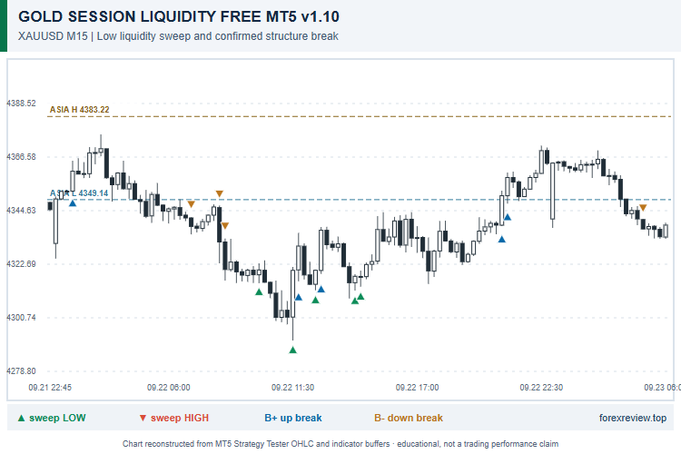
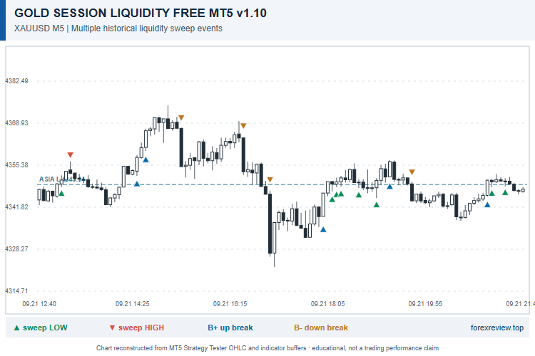

# Gold Session Liquidity Free — MetaTrader 4 & MetaTrader 5

**Free, educational XAUUSD market-context and manual risk-planning indicators** by FXLINER / [ForexReview.top](https://forexreview.top/).

These are **two different platform implementations**, not the same executable and not automated trading robots. Both are intended for chart study. No trading profitability is claimed or guaranteed.

## Official downloads and full documentation

| Edition | Source file | Official Code Base |
| --- | --- | --- |
| MetaTrader 4 v1.10 | [MT4 source](MT4/Gold_Session_Liquidity_Free_MT4.mq4) | [Code Base #79799](https://www.mql5.com/en/code/79799) |
| MetaTrader 5 v1.10 | [MT5 source](MT5/Gold_Session_Liquidity_Free_MT5.mq5) | [Code Base #79797](https://www.mql5.com/en/code/79797) |

**[Full illustrated user guide at ForexReview.top — features, calculations, setup, inputs, differences and limitations](https://forexreview.top/2026/11/19/gold-session-liquidity-free-mt4-mt5-guide/)**

## Main features

- **Session context** — Asian session, London, New York and overlap, with configurable historical broker UTC offset and DST handling. The settings must match the broker.
- **Completed Asian High and Low** — the historical Asian range becomes available after the configured Asian session ends.
- **Closed-bar liquidity sweeps** — OHLC-based detection of reference-level penetration and a reclaim or rejection at candle close. This is a price-action proxy, not a measurement of resting institutional orders.
- **Market structure breaks** — separate confirmed swing-break up and down markers.
- **Trend context** — informational higher-timeframe EMA 20/50 direction, with H1 used by default.
- **Manual risk planner** — an equity-based planning budget, manually entered entry/stop, and estimated lot size using broker-provided symbol contract data.

The MT5 version has additional sweep filters, 17 public indicator buffers, and optional **experimental research signals, disabled by default**. The MT4 version has six buffers and does not include those experimental signals. Output need not match across platforms.

**MT4 caution:** its v1.10 tick-size/tick-value lot conversion has not been independently verified across all broker contract specifications. Confirm any volume with a separate broker-aware calculation before using it. Gaps, slippage, commissions and spread changes can cause actual losses beyond the initial stop-loss budget.

## Install

1. Download the MQ4 source for MetaTrader 4 or MQ5 source for MetaTrader 5.
2. In your terminal select **File → Open Data Folder**.
3. Place the MT4 source under **MQL4/Indicators** or the MT5 source under **MQL5/Indicators**. A GoldSessionLiquidityFree subfolder is optional.
4. Compile in the appropriate MetaEditor and refresh the Navigator list.
5. Attach to your broker's gold symbol and verify the historical server UTC offset and DST setting. M5/M15 are convenient chart-study examples, **not optimized trading periods**.

For input values and buffer maps read [MT4 notes](MT4/README_EN.md), [MT5 notes](MT5/README_EN.md), [Indonesian MT5 notes](MT5/README_ID.md), and the full [ForexReview.top user guide](https://forexreview.top/2026/11/19/gold-session-liquidity-free-mt4-mt5-guide/).

## Examples — illustrative historical reconstructions

*Reconstructed from MT5 Strategy Tester OHLC and indicator buffers. Not a direct terminal screenshot, backtest profitability result, or indication of executed trades.*

*Reconstructed MT5 historical chart for educational display; actual charts vary with broker data and settings.*

Additional MT4-concept illustrations: [low sweep](docs/images/mt4-low-sweep-illustration.png) and [high sweep](docs/images/mt4-high-sweep-illustration.png). These are labeled illustrations derived from MT5 historical data, not direct MT4 screen captures.

## License, attribution, risk warning

This project does not place, modify or close trades. Markers are **descriptive observations, not recommendations to buy or sell**. No positive out-of-sample profitability is established for related experimental strategies.

MIT-licensed release. Preserve the original MIT copyright attribution for Smart Liquidity Hunter-derived portions; see [LICENSE](LICENSE) and [THIRD_PARTY_NOTICES.txt](THIRD_PARTY_NOTICES.txt).

**Publisher:** FXLINER — [ForexReview.top](https://forexreview.top/) · [MQL5 profile](https://www.mql5.com/en/users/fxliner).
